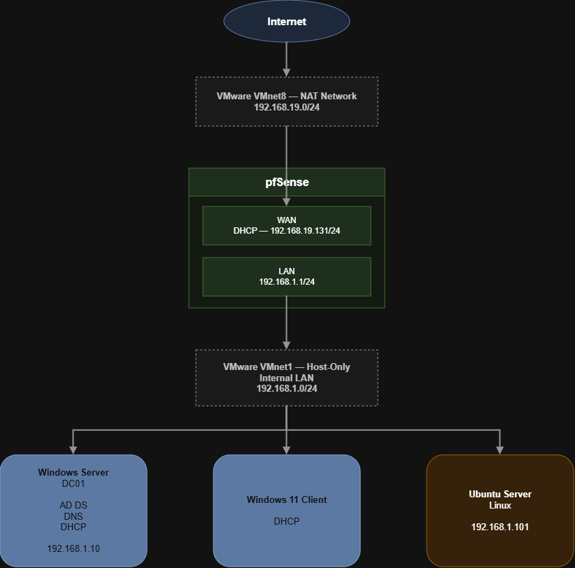
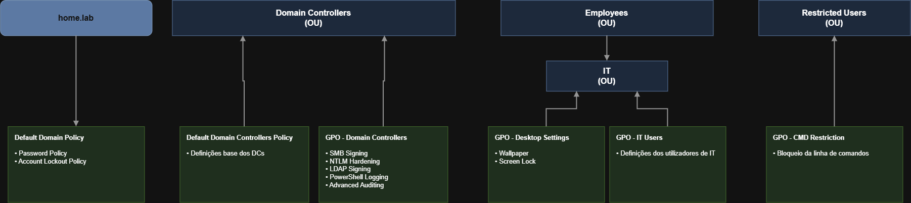

# Enterprise Home Lab

A realistic enterprise home lab designed to develop practical skills in Windows infrastructure, system administration and cybersecurity.

The environment simulates a small enterprise network using VMware Workstation Pro, pfSense, Windows Server, Active Directory and Ubuntu Server. Throughout this project, enterprise networking, Windows administration, security hardening and infrastructure documentation are implemented to create a scalable and maintainable enterprise environment.

---

# Project Goals

- Build a realistic enterprise infrastructure
- Deploy and manage Active Directory
- Configure enterprise networking using pfSense
- Implement Windows security hardening
- Apply Group Policy administration
- Document every deployment step
- Create a reusable cybersecurity laboratory

---

# Infrastructure Overview

| Component | Technology |
|-----------|------------|
| Hypervisor | VMware Workstation Pro |
| Firewall | pfSense |
| Domain Controller | Windows Server |
| Client | Windows 11 Enterprise |
| Linux Server | Ubuntu Server |
| Directory Service | Active Directory Domain Services |
| Name Resolution | DNS |
| Address Assignment | DHCP |
| Policy Management | Group Policy |

---

# Infrastructure Diagrams

## Enterprise Architecture


---

## Network Topology



---

## Active Directory Structure


---

## Group Policy Structure



---

# Project Structure

```text
HOMELAB-ENTERPRISE
│
├── diagrams/
│   ├── ActiveDirectory.drawio
│   ├── ActiveDirectory.drawio.png
│   ├── Arquitetura.drawio
│   ├── Arquitetura.drawio.png
│   ├── GroupPolicy.drawio
│   ├── GroupPolicy.drawio.png
│   ├── NetworkDiagram.drawio
│   └── NetworkDiagram.drawio.png
│
├── modules/
│   ├── 00-Overview
│   ├── 01-VMware
│   ├── 02-pfSense
│   ├── 03-Active-Directory
│   ├── 04-DNS
│   ├── 05-DHCP
│   ├── 06-Group-Policy
│   ├── 07-Windows-Hardening
│   ├── 08-Ubuntu
│   └── 09-Troubleshooting
│
├── CHANGELOG.md
├── LICENSE
├── README.md
└── ROADMAP.md
```

---

# Project Modules

| Module | Description |
|---------|-------------|
| 00 - Overview | Enterprise infrastructure overview |
| 01 - VMware | VMware Workstation Pro deployment and networking |
| 02 - pfSense | Firewall, routing and network configuration |
| 03 - Active Directory | Active Directory Domain Services deployment |
| 04 - DNS | DNS server configuration and name resolution |
| 05 - DHCP | DHCP server configuration and address management |
| 06 - Group Policy | Group Policy deployment and administration |
| 07 - Windows Hardening | Windows security hardening and auditing |
| 08 - Ubuntu | Ubuntu Server deployment and configuration |
| 09 - Troubleshooting | Common deployment issues and solutions |

---

# Technologies

- VMware Workstation Pro
- pfSense
- Windows Server
- Windows 11 Enterprise
- Ubuntu Server
- Active Directory Domain Services
- DNS
- DHCP
- Group Policy
- PowerShell

---

# Security Features

- SMB Signing
- SMBv1 Disabled
- NTLM Hardening
- LDAP Signing
- PowerShell Module Logging
- PowerShell Script Block Logging
- Windows Auditing
- AutoRun Disabled

---

# Documentation

Every infrastructure component is documented with:

- Overview
- Installation
- Configuration
- Validation
- Troubleshooting
- Lessons Learned
- References

---

# Roadmap

Future improvements include:

- Wazuh
- Sysmon
- Windows Event Forwarding (WEF)
- Active Directory Certificate Services (AD CS)
- Microsoft LAPS
- Docker
- Linux Hardening
- Security Monitoring
- Enterprise Logging
- Additional Enterprise Services

For the complete roadmap, see:

**[ROADMAP.md](ROADMAP.md)**

---

# Changelog

Project updates are documented in:

**[CHANGELOG.md](CHANGELOG.md)**

---

# License

This project is released under the MIT License.

See:

**[LICENSE](LICENSE)**

---

# Author

This repository documents the design, deployment and continuous improvement of an enterprise home laboratory for learning Windows infrastructure, enterprise networking and cybersecurity.