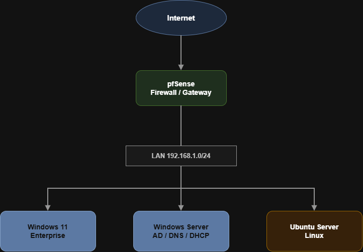

# Overview

## Introduction

The Enterprise Home Lab is a personal infrastructure project designed to simulate a realistic enterprise environment. The laboratory was built from scratch to gain practical experience with Windows infrastructure administration, networking, Group Policy management and security hardening.

Instead of focusing on isolated technologies, the environment integrates multiple enterprise services into a single domain infrastructure that closely resembles a production environment.

Every implementation is documented to create a reusable knowledge base while allowing the laboratory to evolve with additional technologies over time.

---

# Project Goals

The primary objectives of this laboratory are:

- Build a realistic enterprise infrastructure
- Develop hands-on experience with Windows Server administration
- Deploy and manage Active Directory Domain Services
- Configure enterprise networking
- Implement Group Policy Objects (GPOs)
- Apply Windows security hardening techniques
- Document every deployment step
- Create a scalable environment for future technologies

---

# Infrastructure Overview

The laboratory currently consists of six virtual machines running inside VMware Workstation Pro.

| Virtual Machine | Purpose |
|-----------------|---------|
| pfSense | Firewall and Gateway (DHCP, NAT, routing) |
| Windows Server 2022 | Domain Controller (Active Directory, DNS, GPO) |
| Windows 11 Enterprise | Domain client endpoint (Wazuh agent) |
| Ubuntu Server | Storage server (RAID 5 + LVM + NFS) |
| Wazuh | Centralised logging and monitoring |
| Kali Linux | Security testing / attacker |

---

# Project Architecture

---

# Network Design

The environment is divided into two logical networks.

| Network | Purpose |
|----------|---------|
| NAT Network | Internet connectivity |
| Host-Only Network | Internal enterprise network |

All internal communication between the virtual machines takes place through the isolated Host-Only network, while pfSense acts as the gateway between the internal network and the external NAT network.

---

# Technologies Used

## Virtualization

- VMware Workstation Pro

## Networking

- pfSense
- NAT
- Host-Only Networking

## Microsoft Technologies

- Windows Server
- Active Directory
- DNS
- DHCP
- Group Policy
- PowerShell

## Linux

- Ubuntu Server

---

# Project Modules

| Module | Description |
|----------|-------------|
| 01 - VMware | Virtualization infrastructure |
| 02 - pfSense | Firewall and networking |
| 03 - Active Directory | Domain services |
| 04 - DNS | Name resolution |
| 05 - DHCP | Address assignment |
| 06 - Group Policy | Centralized management |
| 07 - Windows Hardening | Security baseline |
| 08 - Ubuntu | Ubuntu storage server (RAID 5 + LVM + NFS) |
| 09 - Troubleshooting | Problems and solutions |
| 10 - Wazuh | Centralised logging, detection and response |
| 11 - Attack Scenarios | Kali intrusion testing and defence validation |

---

# Project Workflow

The project was developed following a structured deployment process.

1. VMware infrastructure
2. Virtual networking
3. pfSense deployment
4. Windows Server installation
5. Active Directory deployment
6. DNS configuration
7. DHCP configuration
8. Windows client deployment
9. Group Policy implementation
10. Security hardening
11. Documentation

---

# Learning Objectives

This laboratory focuses on developing practical skills in:

- Enterprise Networking
- Windows Server Administration
- Active Directory
- DNS
- DHCP
- Group Policy
- Windows Security
- Linux Administration
- Technical Documentation

---

# Future Expansion

The environment has been designed to support future technologies without requiring major architectural changes.

Future additions may include:

- Sysmon
- Windows Event Forwarding
- Wazuh
- Active Directory Certificate Services
- Docker
- Microsoft Defender configuration
- Linux hardening

---

# References

- Microsoft Learn
- VMware Documentation
- pfSense Documentation
- Ubuntu Documentation