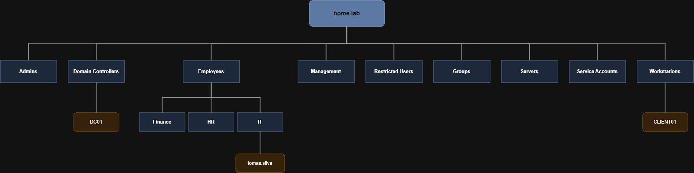

# Active Directory

## Overview

Active Directory Domain Services (AD DS) was deployed as the core identity and management platform for the laboratory. It provides centralized authentication, authorization and administration for all Windows systems within the domain.

The Domain Controller is responsible for managing users, groups, computers and Group Policy Objects, providing a realistic enterprise environment for administration and security testing.

---

# Why Active Directory

Active Directory was selected because it is the standard identity management solution used in enterprise Windows environments.

Implementing Active Directory allows centralized management of users, computers, security policies and network resources while closely simulating a production infrastructure.

---

# Forest

A single forest was deployed for the laboratory.

| Property | Value |
|----------|-------|
| Forest Name | home.lab |
| Domain Controller OS | Windows Server 2022 |
| Forest Functional Level | Windows Server 2016 |

The forest represents the highest security boundary within the environment and contains all domain resources.

---

# Domain

A single Active Directory domain was configured.

| Property | Value |
|----------|-------|
| Domain Name | home.lab |
| NetBIOS Name | HOME |

The domain provides centralized authentication and management for all joined systems.

---

# Domain Controller

A single Windows Server virtual machine was promoted to Domain Controller.

The Domain Controller provides:

- Active Directory Domain Services
- DNS
- Authentication
- Group Policy
- Centralized administration

---

# Organizational Units (OUs)

The directory was organized using Organizational Units to simplify administration and Group Policy deployment.

Current Organizational Units:

- **Admin-Accounts** — dedicated administrative accounts
- **Company-Users** — standard users, with department sub-OUs:
  - Contabilidade (Accounting)
  - HR
  - IT
  - Management
- **Workstations** — domain-joined client computers
- **Groups** — security groups
- **Domain Controllers** — the DC(s)

The OU structure allows policies to be applied only where required (for example, the
Command Prompt restriction on the IT OU and the department drive mapping on the
Contabilidade OU) while keeping the directory organized.

---

# Users

User accounts were created to simulate a small enterprise environment.

Examples include:

- Administrator (built-in, emergency use)
- adm.rodrigo (dedicated administrative account, in Admin-Accounts)
- Standard users placed in their department OU (e.g. Ana Costa in Contabilidade)

Different accounts were created to separate administrative tasks from standard user
activities, following the principle of least privilege.

---

# Groups

Security groups were used to organize users according to their responsibilities.

This simplifies permission management and allows Group Policies to be applied more efficiently.

---

# Security Groups

Security groups were implemented following the principle of role-based administration.

Rather than assigning permissions directly to users, permissions are assigned to groups whenever possible.

This approach improves scalability and simplifies administration.

---

# Administrative Accounts

Administrative tasks are performed using dedicated administrative accounts rather than standard user accounts.

This follows the principle of least privilege and reduces the exposure of privileged credentials during daily activities.

---

# Domain Join Process

Client systems were successfully joined to the Active Directory domain.

After joining the domain, authentication is performed using domain credentials, allowing centralized policy management through Group Policy.

---

# Active Directory Structure

---

# Validation

The Active Directory deployment was validated by confirming:

- Successful Domain Controller promotion
- Successful DNS resolution
- Successful domain authentication
- Successful domain join
- Group Policy application
- User authentication
- Organizational Unit functionality

---

# Lessons Learned

This module provided practical experience with:

- Active Directory deployment
- Domain Controller administration
- User management
- Group management
- Organizational Unit design
- Domain administration
- Authentication troubleshooting

---

# References

- Microsoft Learn
- Active Directory Documentation