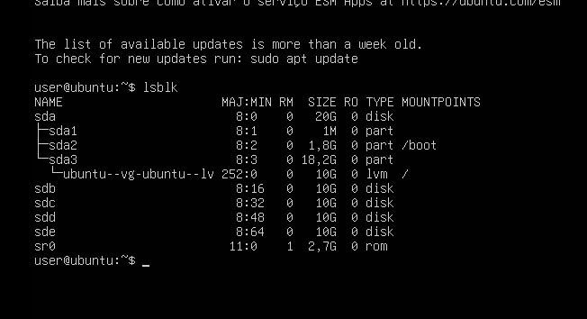
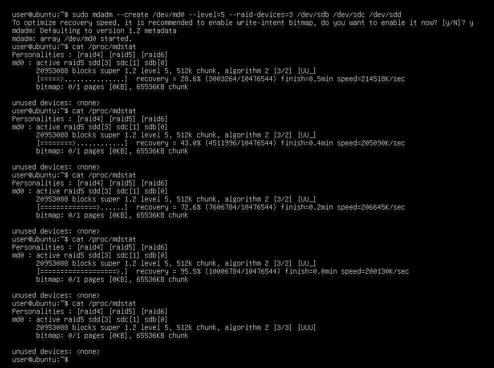
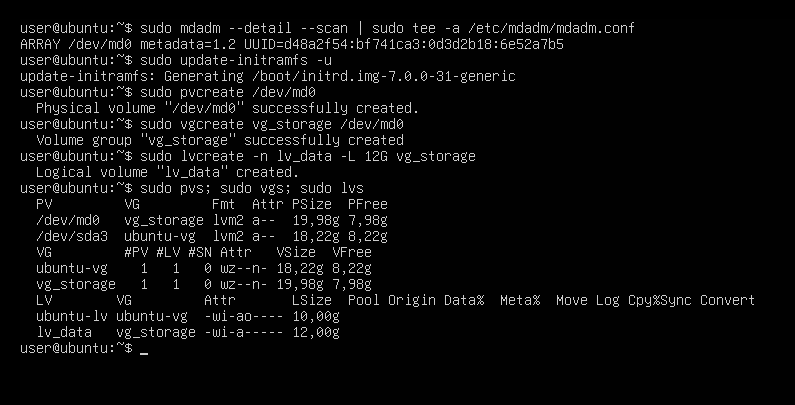
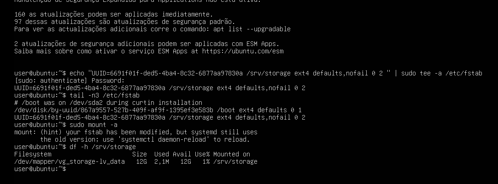
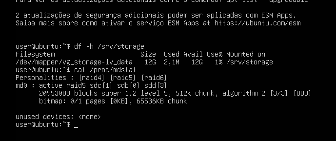
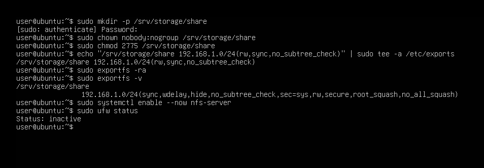
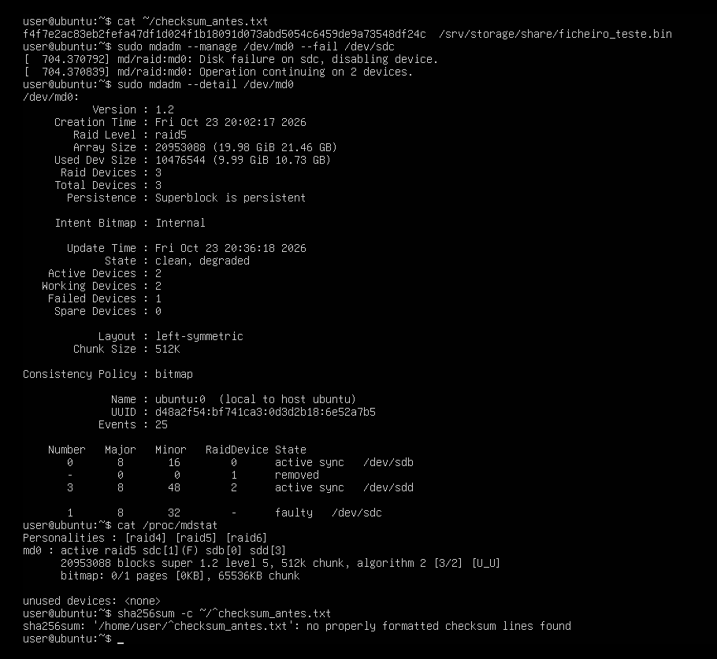
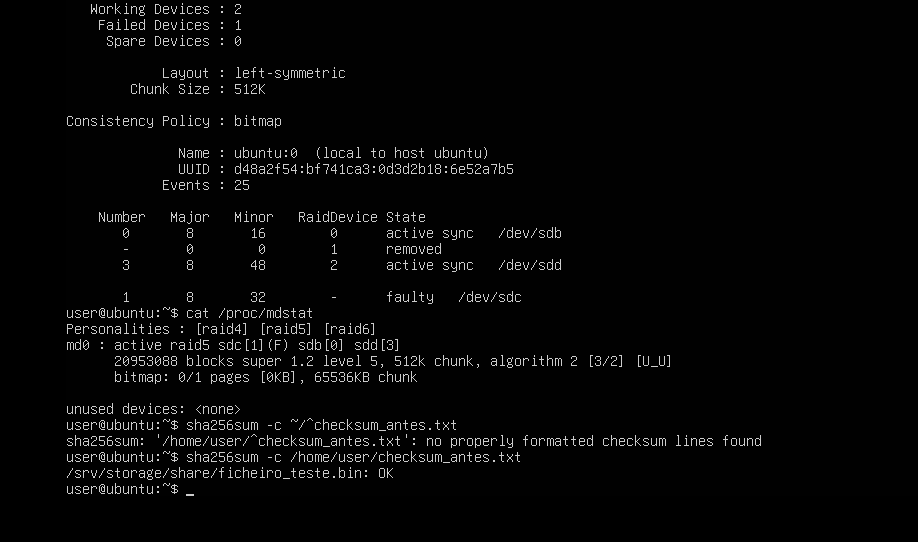
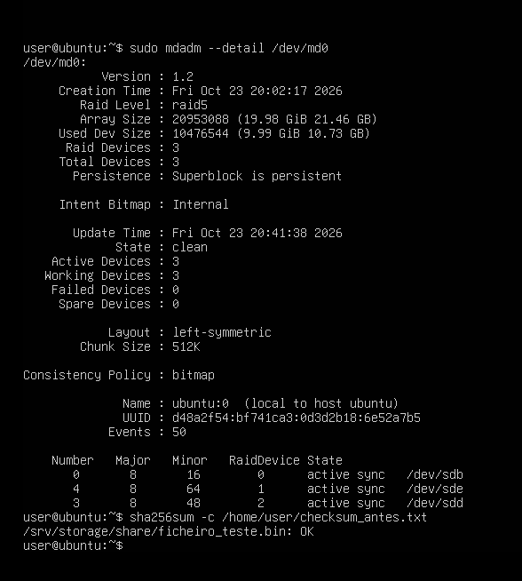

# Ubuntu Storage Server

## Overview

An Ubuntu Server virtual machine provides a Linux storage layer for the laboratory.
It runs a resilient storage stack built from **software RAID 5 (mdadm)**, **LVM** volumes
with **persistent mounts**, and an **NFS** export for Linux clients. Fault tolerance was
validated end to end by simulating a disk failure, replacing the disk and rebuilding the
RAID array, while proving the data stayed intact with a checksum.

This machine also introduces Linux administration into an otherwise Windows-centric
environment, simulating a mixed Windows/Linux infrastructure.

---

# Why a Storage Server

Storage is a core infrastructure service in any enterprise. Building it here provided
hands-on experience with:

- Software RAID and redundancy
- Logical Volume Management (LVM)
- Persistent filesystem mounts
- Network file sharing (NFS)
- Disk-failure handling and array rebuild

---

# Server Specifications

| Component | Detail |
|-----------|--------|
| OS | Ubuntu Server |
| System disk | `sda` (20 GB) |
| Data disks | `sdb`, `sdc`, `sdd` (10 GB each, RAID 5) |
| Spare disk | `sde` (10 GB, replacement for the failure test) |
| Network | Internal LAN (192.168.1.0/24), static address |

---

# Architecture

```
       NFS client  ──NFS (tcp/2049)──►  Ubuntu Storage Server
                                               │
                                       /srv/storage/share
                                               │
                                           ext4 filesystem
                                               │
                                  LVM  (vg_storage / lv_data)
                                               │
                                  Software RAID 5  (/dev/md0)
                                               │
                         ┌──────────────┬──────────────┐
                       sdb            sdc            sdd   (+ sde spare)
```

RAID 5 across three 10 GB disks gives roughly 20 GB of usable space (one disk's worth is
parity) and tolerates the loss of **one** disk.

---

# Deployment

## Packages

```bash
sudo apt install -y mdadm lvm2 nfs-kernel-server
```

## RAID 5 array

```bash
sudo mdadm --create /dev/md0 --level=5 --raid-devices=3 /dev/sdb /dev/sdc /dev/sdd
cat /proc/mdstat        # wait for sync -> [3/3] [UUU]
```

Made persistent across reboots:

```bash
sudo mdadm --detail --scan | sudo tee -a /etc/mdadm/mdadm.conf
sudo update-initramfs -u
```

## LVM

```bash
sudo pvcreate /dev/md0
sudo vgcreate vg_storage /dev/md0
sudo lvcreate -n lv_data -L 12G vg_storage
```

## Filesystem and persistent mount (by UUID)

```bash
sudo mkfs.ext4 /dev/vg_storage/lv_data
sudo mkdir -p /srv/storage
sudo blkid /dev/vg_storage/lv_data
```

`/etc/fstab`:

```
UUID=<uuid>  /srv/storage  ext4  defaults,nofail  0  2
```

The mount uses the filesystem **UUID** (stable across reboots, unlike `/dev/sdX`) and the
**`nofail`** option so the system still boots if the volume is ever unavailable.

## NFS export

```bash
sudo mkdir -p /srv/storage/share
sudo chown nobody:nogroup /srv/storage/share
sudo chmod 2775 /srv/storage/share
echo "/srv/storage/share 192.168.1.0/24(rw,sync,no_subtree_check)" | sudo tee -a /etc/exports
sudo exportfs -ra
sudo systemctl enable --now nfs-server
```

## NFS client access (Linux)

The share is exported to the internal LAN and can be mounted from any Linux client on
`192.168.1.0/24` (for example the Kali VM):

```bash
sudo apt install -y nfs-common
sudo mkdir -p /mnt/nfs
sudo mount -t nfs <UBUNTU_IP>:/srv/storage/share /mnt/nfs
echo "NFS test from client" | sudo tee /mnt/nfs/client_test.txt
```

A file written here appears on the server in `/srv/storage/share`, confirming read/write
access over NFS.

---

# Fault-Tolerance Test (Disk Failure and Rebuild)

1. Create test data and a checksum fingerprint:

   ```bash
   sudo dd if=/dev/urandom of=/srv/storage/share/ficheiro_teste.bin bs=1M count=500
   sha256sum /srv/storage/share/ficheiro_teste.bin > ~/checksum_antes.txt
   ```

2. Simulate a disk failure:

   ```bash
   sudo mdadm --manage /dev/md0 --fail /dev/sdc   # array goes degraded, [3/2] [U_U]
   ```

3. Prove the data is still intact while degraded:

   ```bash
   sha256sum -c ~/checksum_antes.txt              # OK -> lost a disk, lost no data
   ```

4. Replace the disk and rebuild:

   ```bash
   sudo mdadm --manage /dev/md0 --remove /dev/sdc
   sudo mdadm --manage /dev/md0 --add /dev/sde
   watch cat /proc/mdstat                         # recovery 0% -> 100%
   sudo mdadm --detail /dev/md0                   # back to State: clean, [3/3] [UUU]
   sha256sum -c ~/checksum_antes.txt              # still OK after the rebuild
   ```

---

# Validation

The storage deployment was validated by confirming:

- RAID 5 array assembled and synced (`[3/3] [UUU]`)
- The mount survives a reboot automatically (RAID in mdadm.conf + initramfs, mount by UUID)
- With one disk failed, the array ran degraded and the data stayed readable and verified
- After replacing the disk, the array rebuilt to clean and the data was still intact

---

# Evidence

| Step | Screenshot |
|------|------------|
| Data disks added (`lsblk`) |  |
| RAID 5 created and synced (`[3/3] [UUU]`) |  |
| LVM (`pvs` / `vgs` / `lvs`) |  |
| Persistent mount (`/etc/fstab` + `df -h`) |  |
| Mount survives reboot (`df -h` + `/proc/mdstat`) |  |
| NFS export (`exportfs -v`) |  |
| Disk failure — array degraded (`[3/2] [U_U]`) |  |
| Data intact while degraded (`sha256sum -c` OK) |  |
| Rebuilt to clean, data still intact (`sha256sum -c` OK) |  |

---

# Lessons Learned

- **RAID 5 tolerates one disk failure.** Usable capacity is `(n - 1)` disks; the rest
  holds distributed parity, which is what allows the rebuild.
- **RAID is not a backup.** It protects against a disk failing, not against deletion,
  corruption or ransomware, which replicate to all disks instantly.
- **LVM adds flexibility** on top of the RAID (online resize, snapshots) independent of
  the physical layout.
- **Mount by UUID with `nofail`** makes the mount reliable and keeps the system bootable.
- **NFS vs SMB:** NFS suits Linux-to-Linux sharing; SMB is used when Windows clients are
  involved (and integrates with Active Directory).
- **`root_squash`** maps a client's root to `nobody` on the server, limiting what a client
  root can do to exported files.

---

# References

- Ubuntu Server Documentation
- Linux `mdadm`, LVM and NFS documentation
